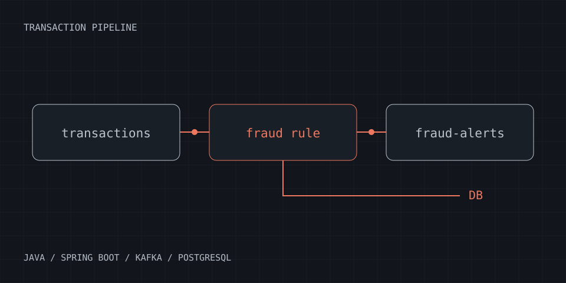
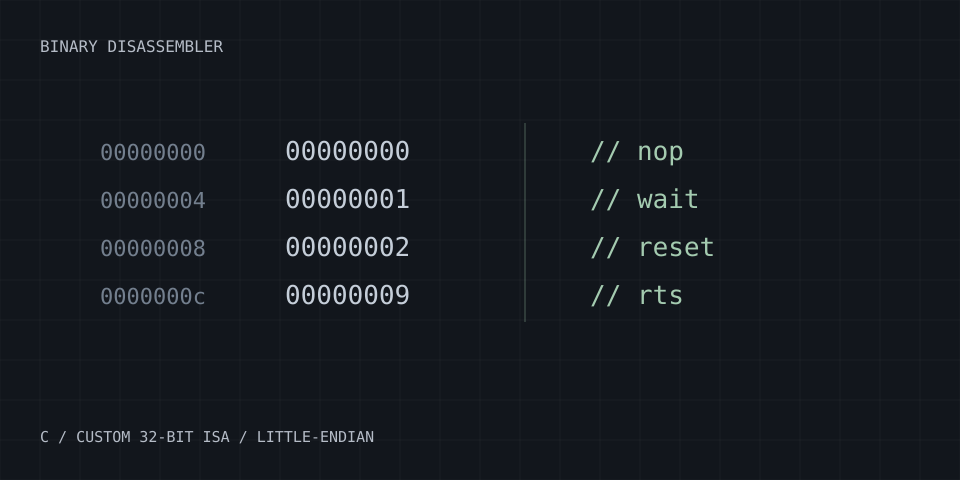
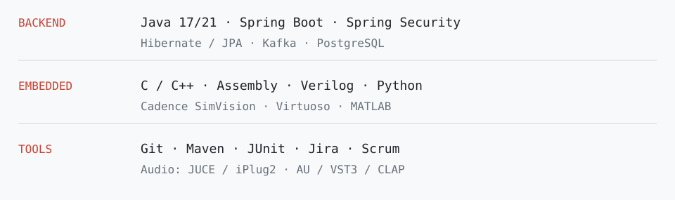

<picture>
  <source media="(prefers-color-scheme: dark)" srcset="assets/name-dark.svg">
  
</picture>

  Я Семён. Пишу Java-сервисы, разбираюсь с микроконтроллерами и иногда делаю звук громче.
    
  <a href="https://twoonemoon.github.io/">Портфолио</a> · <a href="https://t.me/twoonemoon">Telegram</a> · <a href="mailto:gridinsams@gmail.com">Почта</a>

## Проекты

<table>
  <tr>
    <td width="50%" valign="top">
      
       <b><a href="https://github.com/twoonemoon/SpringBoot-antifraud">SpringBoot-antifraud</a></b>
       Java 17 · Spring Boot · Kafka · PostgreSQL
      
Обработка транзакций из Kafka, проверка правила по сумме и отправка алертов. Транзакции и срабатывания сохраняются в PostgreSQL.

      <a href="https://github.com/twoonemoon/SpringBoot-antifraud">Исходный код</a>
    </td>
    <td width="50%" valign="top">
      
       <b><a href="https://github.com/twoonemoon/SpringBoot-movie-recommender">SpringBoot-movie-recommender</a></b>
       Java 17 · Spring Boot · JPA · PostgreSQL
      
Рекомендации по любимым жанрам на основе пользовательских оценок. Асинхронное обновление подборки и исключение уже оценённых фильмов.

      <a href="https://github.com/twoonemoon/SpringBoot-movie-recommender">Исходный код</a>
    </td>
  </tr>
  <tr>
    <td width="50%" valign="top">
      
       <b><a href="https://github.com/twoonemoon/PinkGuitarFX">PinkGuitarFX</a></b>
       C++17 · JUCE · VST3 / AU
      
Гитарный дисторшн-плагин: drive, noise gate, эквалайзер, кабинетные IR и тюнер. Немного розового между строками кода.

      <a href="https://github.com/twoonemoon/PinkGuitarFX">Исходный код</a>
    </td>
    <td width="50%" valign="top">
      
       <b><a href="https://github.com/twoonemoon/binpeek">binpeek</a></b>
       C · 32-bit ISA · little-endian
      
Утилита для разбора бинарников собственной 32-битной архитектуры. Читает 4-байтовые слова, декодирует опкоды и формирует текстовый листинг.

      <a href="https://github.com/twoonemoon/binpeek">Исходный код</a>
    </td>
  </tr>
</table>

## Стек

<picture>
  <source media="(prefers-color-scheme: dark)" srcset="assets/stack-dark.svg">
  
</picture>

## Между битами и backend

Мой инженерный бэкграунд — микроконтроллеры, прошивки и RTL-верификация в АО «Ангстрем». Параллельно занимался планированием и координацией проектов. В 2026 году окончил НИУ «МИЭТ», направление «Интегральная электроника».

Сейчас развиваюсь в Java/backend. Java-проекты здесь — самостоятельная практика; коммерческий опыт связан с embedded и микроэлектроникой.

<b>In English</b>

 

I'm Semyon Gridin, a Java developer with an embedded engineering background. I've worked on MCU firmware, 32-bit MCU verification, and project coordination at Angstrem. MIET graduate, Integrated Electronics, 2026.

My Java projects are personal projects. My professional experience is in embedded systems and microelectronics. I also build audio software with C++ and JUCE.

[Portfolio](https://twoonemoon.github.io/) · [Telegram](https://t.me/twoonemoon) · [Email](mailto:gridinsams@gmail.com)

☾ &nbsp; from bits to backend

