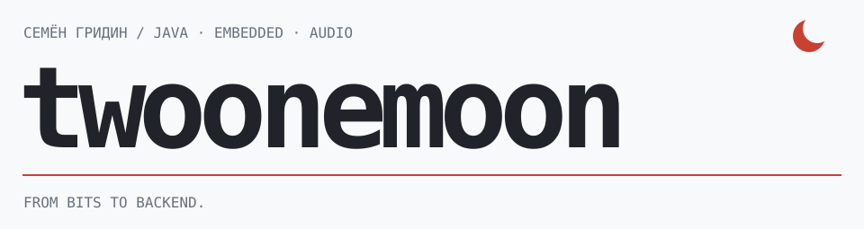
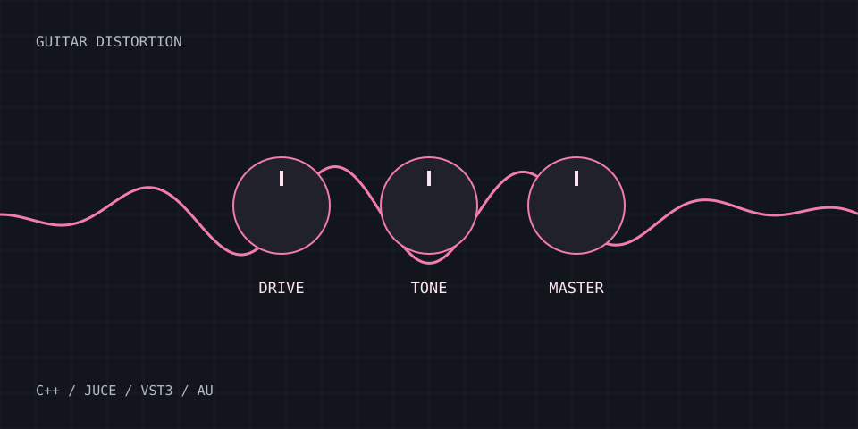

<picture>
  <source media="(prefers-color-scheme: dark)" srcset="assets/name-dark.svg">
  
</picture>

Я Семён. Пишу на Java и C/C++. До Java писал прошивки и занимался верификацией микроконтроллеров. Ещё делаю гитарные плагины.

<a href="https://twoonemoon.github.io/">Сайт</a> · <a href="https://t.me/twoonemoon">Telegram</a> · <a href="mailto:gridinsams@gmail.com">Почта</a>

## Проекты

### [TwoonemoonSoundLab](https://github.com/twoonemoon/TwoonemoonSoundLab)

**C++17 · iPlug2 · AUv2 / VST3 / CLAP / standalone**

Гитарный процессор под macOS на Apple Silicon. Усилители, кабинеты, педали и эффекты в одном плагине. Есть отдельное приложение.

Пока тестовая версия. На реальной гитаре и вручную в DAW ещё не проверен. [Что проверено и что осталось](https://github.com/twoonemoon/TwoonemoonSoundLab/blob/main/docs/PROGRESS.md).

<table>
  <tr>
    <td width="50%" valign="top">
      
       <b><a href="https://github.com/twoonemoon/SpringBoot-antifraud">SpringBoot-antifraud</a></b>
       Java 17 · Spring Boot · Kafka · PostgreSQL
      
Сервис, который получает транзакции из Kafka. Проверяет сумму, при подозрительной операции отправляет алерт. Данные пишет в PostgreSQL.

      <a href="https://github.com/twoonemoon/SpringBoot-antifraud">Код</a>
    </td>
    <td width="50%" valign="top">
      
       <b><a href="https://github.com/twoonemoon/SpringBoot-movie-recommender">SpringBoot-movie-recommender</a></b>
       Java 17 · Spring Boot · JPA · PostgreSQL
      
Подбирает фильмы по жанрам, которым пользователь ставил высокие оценки. Уже оценённые фильмы в подборку не попадают.

      <a href="https://github.com/twoonemoon/SpringBoot-movie-recommender">Код</a>
    </td>
  </tr>
  <tr>
    <td width="50%" valign="top">
      
       <b><a href="https://github.com/twoonemoon/PinkGuitarFX">PinkGuitarFX</a></b>
       C++17 · JUCE · VST3 / AU
      
Гитарный дисторшн на C++ и JUCE. Есть noise gate, эквалайзер, загрузка кабинетных IR и тюнер. Розовый.

      <a href="https://github.com/twoonemoon/PinkGuitarFX">Код</a>
    </td>
    <td width="50%" valign="top">
      
       <b><a href="https://github.com/twoonemoon/binpeek">binpeek</a></b>
       C · 32-bit ISA · little-endian
      
Небольшой дизассемблер на C под нестандартную 32-битную архитектуру. Читает бинарник и выдаёт листинг с названиями инструкций.

      <a href="https://github.com/twoonemoon/binpeek">Код</a>
    </td>
  </tr>
</table>

## Стек

<picture>
  <source media="(prefers-color-scheme: dark)" srcset="assets/stack-dark.svg">
  
</picture>

## Обо мне

В 2026 окончил МИЭТ, интегральная электроника. В Ангстреме писал прошивки, работал с RTL-моделями и верификацией 32-битного МК. Параллельно вёл проекты: планировал работу и координировал команду.

Сейчас занимаюсь Java/backend. Коммерческого опыта в Java пока нет, есть свои проекты. Рабочий опыт — embedded и микроэлектроника.

Пишите в [Telegram](https://t.me/twoonemoon) или [на почту](mailto:gridinsams@gmail.com).

<b>In English</b>

I'm Semyon Gridin. I write Java and C/C++, and make guitar plugins. I graduated from MIET in 2026, Integrated Electronics. At Angstrem I worked on MCU firmware, RTL models, 32-bit MCU verification, and project coordination.

My work experience is in embedded systems and microelectronics. My Java projects are personal projects; I don't have commercial Java experience yet.

[TwoonemoonSoundLab](https://github.com/twoonemoon/TwoonemoonSoundLab) is a guitar processor for macOS on Apple Silicon, built with C++17 and iPlug2. Test version; not yet tested with a real guitar or manually in a DAW.

[Website](https://twoonemoon.github.io/) · [Telegram](https://t.me/twoonemoon) · [Email](mailto:gridinsams@gmail.com)

